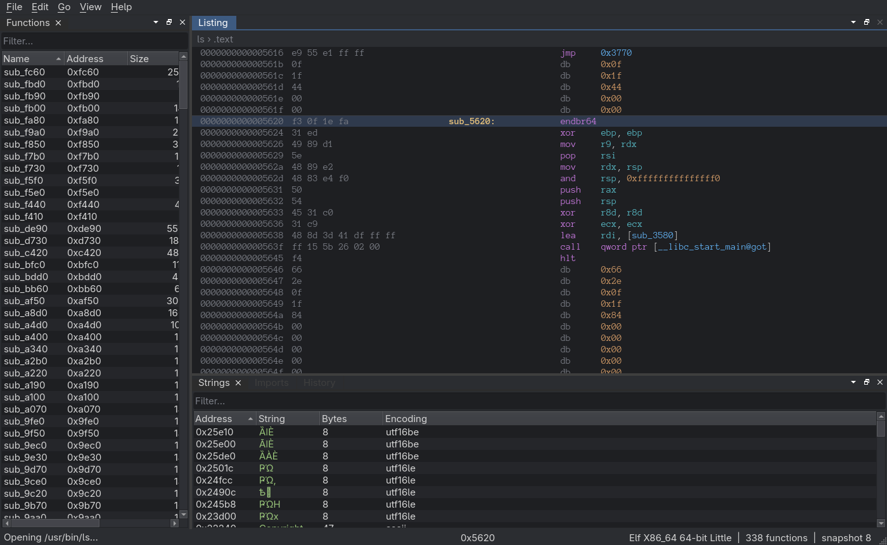

+++
title = "rasm: a Linux-first disassembler in Rust and Qt"
date = 2026-11-08
draft = false
tags = ["reversing", "rust", "tools"]
summary = "rasm is a new disassembler for Linux with a Rust core and a native Qt interface. Version 0.1 loads x86-64 ELF binaries, finds functions, and matches objdump on every test binary. This post covers the parts that turned out to be interesting, and the parts that are still broken."
+++

<div class="not-prose my-8 rounded-lg border border-neutral-200 bg-neutral-50 p-4 text-sm leading-relaxed dark:border-neutral-800 dark:bg-neutral-900/50">
  <p class="m-0"><strong>Project:</strong> <a href="https://github.com/hed1ad/rasm">hed1ad/rasm</a></p>
  <p class="m-0 mt-1"><strong>Stack:</strong> Rust core, C++ Qt 6 Widgets UI, cxx-qt bridge</p>
  <p class="m-0 mt-1"><strong>Status:</strong> 0.1, x86-64 ELF only</p>
  <p class="m-0 mt-1"><strong>License:</strong> Apache-2.0</p>
</div>

I spend most of my time on Linux, and most of the binaries I look at are ELF. IDA costs a lot of money, Ghidra takes a while to start and shows me twenty windows I don't need. I wanted something native that opens instantly, lets me keep working while analysis runs, and treats ELF as the main format instead of one of many.



It is early. There is no decompiler or graph view yet and the interface needs a redesign. The analysis core works though, so here is what it does and what I learned getting it to work.

## Running it

```console
$ dasm analyze /usr/bin/ls
file:       /usr/bin/ls
sha256:     29abfee0d588cfbee70103be11aa0a2f81b0d8c1292341e2345fc9f3ffa1558b
format:     Elf PieExecutable X86_64
functions:  338
insns:      24749
xrefs:      7469
strings:    723
analysis:   83 ms
```

The same core drives `dasm-gui`. Analysis runs on a thread pool and publishes immutable snapshots. The UI only reads snapshots, so it never waits on a pass. Every edit, such as a rename or a comment, is an operation written to a journal in a SQLite project file. Undo is the inverse operation and analysis results are a cache that can be thrown away.

## The ELF parser

A disassembler opens files that were built to break it, so the loader is the first thing I care about. The original plan was to use goblin. In the end the ELF parsing is its own small module, because I wanted every bounds check in one place and I wanted broken files to load as far as possible instead of failing.

Almost everything goes through this reader:

```rust
fn take<const N: usize>(&mut self) -> Option<[u8; N]> {
    let end = self.off.checked_add(N)?;
    let b: [u8; N] = self.data.get(self.off..end)?.try_into().ok()?;
    self.off = end;
    Some(b)
}
```

There is no indexing and no pointer casting, so a truncated table is just a `None`. Table sizes are computed with `checked_mul` and compared against limits before anything is allocated.

gimli still handles DWARF and `.eh_frame`, and that is where the first real problems showed up.

## One megabyte of DWARF, two gigabytes of RAM

The first version copied the name of every `DW_TAG_subprogram` into a `String`. That looks harmless until you remember that many DIEs can point at the same entry in `.debug_str`. A 1 MB file with one 1 MB string and 2000 DIEs referencing it took 12 seconds and peaked at 2 GB of memory.

The second one was in abbreviations. Without a cache, gimli parses the abbreviation table again for every unit. 20,000 empty units sharing one table of 10,000 abbreviations is a 300 KB file that took 31 seconds to load.

The fix for both is the same idea. File size says nothing about how much work a file can cause, so the loader keeps explicit budgets:

```rust
pub(crate) fn charge(&self, n: u64) -> Res<()> {
    match self.0.get().checked_sub(n) {
        Some(left) => {
            self.0.set(left);
            Ok(())
        }
        None => Err(LoadError::LimitExceeded(
            "string data copied from the file exceeds the load budget".into(),
        )),
    }
}
```

Every copied string is charged, including names that end up being skipped. Abbreviation tables are measured with a linear scan before they are parsed.

There is a limit to this. An early attempt at reporting these limits made the loader refuse a file when one field in `PT_DYNAMIC` claimed a huge size, and the binary would most likely still run fine. For a disassembler that is a free anti-analysis trick. Data like symbol versions is advisory now, and running out of budget on it keeps what was already read.

## Finding function bodies

Function starts on stripped binaries are mostly a solved problem on Linux, because `.eh_frame` has them. rasm finds 333 of 333 FDE starts in `ls`. Getting the bodies right was harder.

The first full comparison against objdump covered only 77% of the bytes inside FDE ranges. Recursive descent stops at an indirect `jmp`, so anything behind a `switch` is never reached. I don't resolve jump tables yet. Instead, the FDE size says where the function ends, so undecoded gaps inside that range get decoded as part of the function, starting only where a previous instruction ended. Coverage on `ls` went from 77% to 100%.

The golden tests also caught a funny one. In static glibc builds the FDE for `__restore_rt` starts one byte before the function, in the middle of a padding instruction. Trusting it produced three instructions that objdump doesn't have, so hints that land inside padding now move to the end of the padding.

Arch builds with `-fno-plt`, so most calls look like this:

```text
call    qword ptr [__libc_start_main@got]
```

Without a separate index of GOT slots the listing would only show an address there, and `exit` or `abort` called this way would not be recognized as `noreturn`.

## Project files are input too

A `.dasm` file is SQLite, and someone can send you one. The first hardening pass checked the schema against what the migrations produce, so a project can't replace a table with a `VIEW` containing an infinite recursive CTE. It also installed a progress handler to interrupt runaway queries.

Then review found that a plain `SELECT count(*) FROM journal` still hung. The schema was untouched, but the b-tree pages in a 49 KB file were arranged so internal pages pointed into each other. `count(*)` is a single opcode and the progress handler never runs inside it. The count is gone now, and rows are counted while reading so the loop can stop at the limit.

## Testing against binutils

The test suite builds 37 binaries from gcc, clang, musl, Go and Rust, with and without PIE, stripped and not, and compares the output with `readelf`, `objdump` and `nm`.

The first version of those tests could be fooled. A `dasm` that created one empty function per FDE and emitted no instructions passed everything, because 100% of FDE starts were found and there were no instructions to compare. A crashed `objdump` also counted as a pass, since empty output meant nothing mismatched. Now the tests require instruction coverage inside FDE ranges, check exit codes of the tools, and each hole has a test feeding in a deliberately wrong report. In strict mode a skip counts as a failure.

## What is broken

Quite a lot, and it's all [in the issues](https://github.com/hed1ad/rasm/issues). The ones that matter most:

**Don't open malware with it yet.** The function range decoding has no proper global budget, so a crafted file can keep analysis busy for minutes. Fuzzing has only run for 15 minutes per target with no crashes, and the goal is at least an hour.

Incremental analysis can disagree with a full analysis after you patch bytes. Names aren't demangled. Only x86-64 is supported. Short byte runs get reported as UTF-16 strings, which is the garbage at the top of the strings panel in the screenshot.

The UI is the next thing to change. It works, but it looks like a default Qt docking layout, so it is going to be rebuilt around a sidebar and a full-width listing, closer to a code editor.

## References

1. [hed1ad/rasm](https://github.com/hed1ad/rasm)
2. [gimli](https://github.com/gimli-rs/gimli)
3. [iced-x86](https://github.com/icedland/iced)
4. [cxx-qt](https://github.com/KDAB/cxx-qt)
5. [Qt Advanced Docking System](https://github.com/githubuser0xFFFF/Qt-Advanced-Docking-System)
